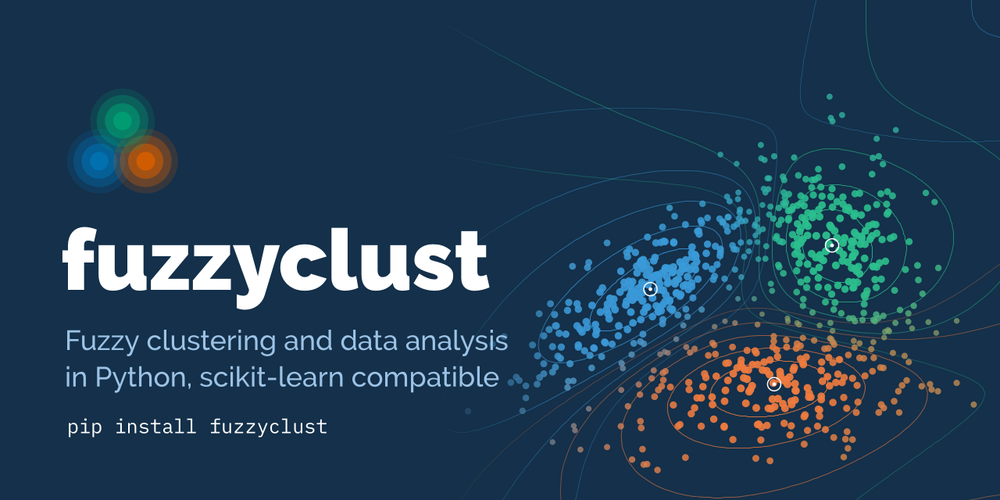

<p align="center"></p>

# fuzzyclust: fuzzy clustering and data analysis in Python

[](https://github.com/ComplexSystemsIntelligence/fuzzyclust/actions/workflows/ci.yml)
[](https://complexsystemsintelligence.github.io/fuzzyclust)
[](https://pypi.org/project/fuzzyclust/)
[](https://github.com/ComplexSystemsIntelligence/fuzzyclust/blob/main/LICENSE)
[](https://doi.org/10.5281/zenodo.24543754)

**fuzzyclust** is a scikit-learn compatible toolbox for fuzzy clustering and the
data-analysis methods built on it. It succeeds the *Fuzzy Clustering and Data
Analysis Toolbox for MATLAB* (Balaskó, Abonyi, Feil) and collects the
clustering-based methods of the Abonyi group (model identification, time-series
segmentation, visualization of fuzzy clusters, graph-based clustering) together
with the possibilistic, noise, kernel and shape-prototype variants of fuzzy
c-means and methods for relational, incomplete, very large and image data.

| Sub-package | Contents |
|---|---|
| `fuzzyclust.cluster` | k-means, k-medoids, fuzzy c-means, Gustafson–Kessel, Gath–Geva; regularized and polynomial fuzzifiers, deterministic annealing; subtractive and mountain clustering; compatible cluster merging |
| `fuzzyclust.validity` | PC, CE, MPC, SC, S, XB, FS, Dunn, alternative Dunn, silhouette, FHV, PD, APD, PBMF, Kwon, PCAES; fuzzy Rand/ARI; scans and stability-based selection of the number of clusters |
| `fuzzyclust.extensions` | possibilistic c-means, PFCM, noise clustering, kernel FCM, fuzzy c-varieties, fuzzy c-shells, volume prototypes, SCAD and weighted FCM |
| `fuzzyclust.graph` | minimal-spanning-tree hybrid clustering, geodesic-distance fuzzy c-medoids, Isomap-FCM |
| `fuzzyclust.viz` | PCA, Sammon mapping, fuzzy Sammon mapping (FUZZSAM), projection quality, fuzzy self-organizing map |
| `fuzzyclust.models` | Takagi–Sugeno identification by modified Gath–Geva clustering (SISO/MIMO), fuzzy c-regression, supervised fuzzy classifiers, fuzzy partitions for decision trees, hinging-hyperplane regression trees |
| `fuzzyclust.timeseries` | fuzzy segmentation of multivariate series, model-order selection, state-space reconstruction and prediction of chaotic series, structure selection with mixed inputs |
| `fuzzyclust.relational` | relational FCM, NERF c-means, fuzzy c-medoids, fuzzy k-modes / k-prototypes; DTW, autocorrelation and Gower dissimilarities |
| `fuzzyclust.incomplete`, `large`, `image` | FCM with missing values; weighted, sampling, single-pass and online FCM for very large data and streams; spatial FCM variants for image segmentation |
| `fuzzyclust.semisupervised`, `coclustering`, `collaborative`, `ensemble` | partial supervision and pairwise constraints, fuzzy co-clustering, collaborative FCM across sites, fuzzy cluster ensembles |
| `fuzzyclust.datasets`, `preprocessing`, `plotting` | synthetic generators, scaling and regressor construction, plotting helpers |

## Installation

```bash
pip install fuzzyclust
```

Python ≥ 3.10; depends on numpy, scipy, scikit-learn ≥ 1.6, pandas and matplotlib.

## Quick start

```python
from fuzzyclust.cluster import GK
from fuzzyclust.datasets import make_fuzzy_blobs
from fuzzyclust.validity import scan_n_clusters, suggest_n_clusters
from fuzzyclust.plotting import plot_clusters, plot_membership_contours

X, _ = make_fuzzy_blobs(n_clusters=3, random_state=0)

gk = GK(n_clusters=3, m=2.0, random_state=0).fit(X)
gk.membership_          # fuzzy partition U, shape (n_samples, n_clusters)
gk.cluster_centers_     # prototypes v_i
gk.covariances_         # fuzzy covariance matrices F_i
gk.predict_proba(X)     # memberships of (new) samples

table = scan_n_clusters(GK(random_state=0), X, range(2, 8))   # validity indices vs. c
print(suggest_n_clusters(table))

ax = plot_clusters(X, gk.labels_, gk.cluster_centers_)
plot_membership_contours(gk, X, ax=ax)
```

Every estimator follows the scikit-learn conventions (`fit`, `predict`,
`predict_proba`, `transform`, fitted attributes with a trailing underscore),
accepts NumPy arrays or pandas DataFrames and works inside a `Pipeline`.

## Documentation, examples, book

* **Documentation and example gallery**: <https://complexsystemsintelligence.github.io/fuzzyclust>. One
  runnable example per algorithm; each generates its own data, explains the
  method and ends with a study of its parameters. Every example is also a
  Jupyter notebook (download button in the gallery).
* **Book**: *Fuzzy Clustering and Data Analysis in Python: The fuzzyclust
  toolbox*, [PDF](https://complexsystemsintelligence.github.io/fuzzyclust/fuzzyclust-book.pdf)
  (384 pages) and [EPUB](https://complexsystemsintelligence.github.io/fuzzyclust/fuzzyclust-book.epub),
  CC BY 4.0; LaTeX source in `book/`, both files are also attached to every
  release. Theory in one notation, algorithm boxes, and the gallery
  examples as case studies.
* **Migration from the MATLAB toolbox**: Appendix B of the book and
  `docs/migration.rst`.

## Development

```bash
git clone https://github.com/ComplexSystemsIntelligence/fuzzyclust.git && cd fuzzyclust
pip install -e ".[dev]"
pytest                                   # > 3700 tests
ruff check src tests examples book
sphinx-build -b html docs docs/_build/html
book/build.sh                            # cover, figures, appendices, PDF
```

`DESIGN.md` sets the conventions for the code, the docstrings, the examples
and the book (notation, API contract, layout, templates).

## Citing

Please cite the software through its Zenodo record,
[doi:10.5281/zenodo.24543754](https://doi.org/10.5281/zenodo.24543754) (all
versions; version 1.0 is
[doi:10.5281/zenodo.24543755](https://doi.org/10.5281/zenodo.24543755)), or use
`CITATION.cff`. Please also cite the original publications of the methods you
use; they are listed in every docstring and chapter.

## About

fuzzyclust is developed by the HUN-REN–PE Complex Systems Monitoring Research
Group ([AbonyiLab](https://www.abonyilab.com)) at the University of Pannonia,
Veszprém, Hungary. The group's open textbooks and software are collected at
[complexsystemsintelligence.github.io](https://complexsystemsintelligence.github.io/).
The work was supported by the National Research, Development and Innovation
Office of Hungary (NKFIH) through the OTKA 143482 project.

## License

Code: MIT. Book: CC BY 4.0. The MATLAB toolbox this project succeeds was written by Balázs Balaskó,
János Abonyi and Balázs Feil at the University of Veszprém (today University of
Pannonia).
