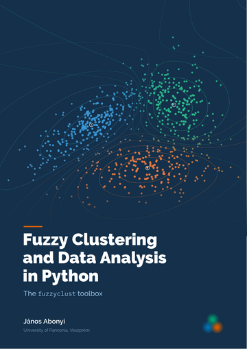

The book
========

*Fuzzy Clustering and Data Analysis in Python: The fuzzyclust toolbox* is the
companion book of the package. It develops every algorithm in one notation,
keeps theory and experiments apart, and illustrates each method with the
scripts of the :doc:`example gallery <auto_examples/index>`, so the book, the
documentation and the code show the same results. The book is published
under the CC BY 4.0 license.

`Download the PDF <fuzzyclust-book.pdf>`__ (384 pages). The PDF of each
version is also attached to its GitHub release.

Contents
--------

1. Introduction: what clustering is for, the lineage of the toolbox, a first session
2. Foundations: data, norms, partition spaces, prototypes, alternating optimization, the API
3. Partitioning algorithms: k-means, k-medoids, fuzzy c-means, Gustafson–Kessel, Gath–Geva, generalized fuzzifiers, subtractive clustering
4. Cluster validity: sixteen indices, scans over the number of clusters, fuzzy Rand indices, stability, cluster merging
5. Visualization: PCA, Sammon mapping, fuzzy Sammon mapping, projection quality, fuzzy SOM
6. Robust and shape-oriented variants: possibilistic, noise, kernel, c-varieties, c-shells, volume prototypes, feature weighting
7. Graph-based fuzzy clustering: minimal spanning trees, geodesic distances
8. Clustering for model identification: Takagi–Sugeno models, fuzzy c-regression, fuzzy classifiers, fuzzy partitions for trees, hinging-hyperplane trees
9. Clustering of time series: segmentation, model order selection, state-space reconstruction and prediction, structure selection
10. Relational and mixed data: relational FCM, NERF c-means, fuzzy c-medoids, categorical and mixed attributes, time series as objects
11. Incomplete, very large, and image data: missing values, sampling and streaming FCM, spatial FCM for images
12. Beyond a single unsupervised run: partial supervision, pairwise constraints, co-clustering, collaborative clustering, ensembles

Appendices: API reference tables, migration from the MATLAB toolbox, catalog of the example scripts.

The PDF is built from the ``book/`` directory of the repository with
``book/build.sh``.
