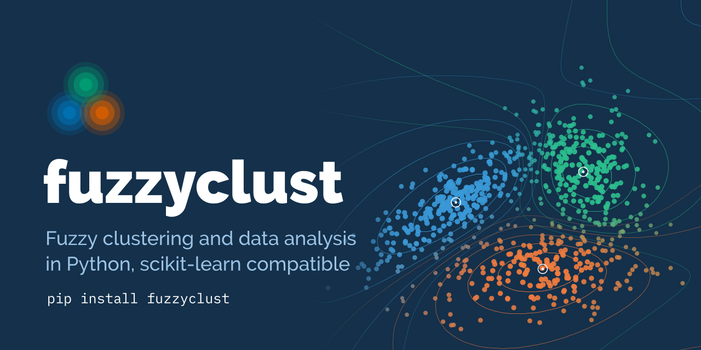

fuzzyclust: fuzzy clustering and data analysis in Python
=========================================================

**fuzzyclust** is a scikit-learn compatible toolbox for fuzzy clustering and
the data-analysis methods built on it. It succeeds the *Fuzzy Clustering and
Data Analysis Toolbox for MATLAB* (Balaskó, Abonyi and Feil) and collects
the clustering-based methods developed in the Abonyi group over two decades:
model identification, time-series segmentation, visualization of fuzzy
clusters and graph-based clustering, together with the possibilistic, noise,
kernel and shape-prototype variants of fuzzy c-means and methods for
relational, incomplete, very large and image data.

.. grid:: 1 2 2 3
   :gutter: 3

   .. grid-item-card:: Core algorithms
      :link: api/cluster
      :link-type: doc

      K-means, k-medoids, fuzzy c-means, Gustafson–Kessel and Gath–Geva on
      one alternating-optimization template; generalized fuzzifiers,
      subtractive clustering, cluster merging.

   .. grid-item-card:: Validity
      :link: api/validity
      :link-type: doc

      Sixteen validity indices, scans over the number of clusters, fuzzy
      Rand indices and stability-based selection.

   .. grid-item-card:: Robust and shape prototypes
      :link: api/extensions
      :link-type: doc

      Possibilistic and noise clustering, kernel FCM, c-varieties, c-shells,
      volume prototypes and feature weighting.

   .. grid-item-card:: Graph-based clustering
      :link: api/graph
      :link-type: doc

      Minimal-spanning-tree hybrids and geodesic-distance fuzzy c-medoids.

   .. grid-item-card:: Visualization
      :link: api/viz
      :link-type: doc

      PCA, Sammon and fuzzy Sammon mapping, projection quality, fuzzy SOM.

   .. grid-item-card:: Models and time series
      :link: api/models
      :link-type: doc

      Takagi–Sugeno identification, fuzzy classifiers, regression trees,
      segmentation, model order, chaotic prediction.

   .. grid-item-card:: Relational and mixed data
      :link: api/relational
      :link-type: doc

      Relational FCM, NERF c-means, fuzzy c-medoids, fuzzy k-modes and
      k-prototypes; DTW, autocorrelation and Gower dissimilarities.

   .. grid-item-card:: Incomplete, large and image data
      :link: api/incomplete
      :link-type: doc

      FCM with missing values; weighted, sampling, single-pass and online FCM;
      spatial FCM variants for image segmentation.

   .. grid-item-card:: Beyond one unsupervised run
      :link: api/semisupervised
      :link-type: doc

      Partial supervision, pairwise constraints, co-clustering, collaborative
      clustering and cluster ensembles.

Quick start
-----------

.. code-block:: bash

   pip install fuzzyclust

.. code-block:: python

   from fuzzyclust.cluster import GK
   from fuzzyclust.datasets import make_fuzzy_blobs
   from fuzzyclust.plotting import plot_clusters, plot_membership_contours

   X, _ = make_fuzzy_blobs(n_clusters=3, random_state=0)
   gk = GK(n_clusters=3, m=2.0, random_state=0).fit(X)

   gk.membership_        # fuzzy partition matrix, shape (n_samples, n_clusters)
   gk.cluster_centers_   # prototypes
   gk.covariances_       # fuzzy covariance matrices of the GK clusters
   gk.predict_proba(X)   # memberships of (new) samples

   ax = plot_clusters(X, gk.labels_, gk.cluster_centers_)
   plot_membership_contours(gk, X, ax=ax)

Every estimator is a scikit-learn estimator: it accepts NumPy arrays or
pandas DataFrames, works inside a :class:`~sklearn.pipeline.Pipeline`, and
exposes its results as fitted attributes.

Where to go next
----------------

* :doc:`installation`: requirements and optional extras.
* :doc:`auto_examples/index`: the **example gallery**: one runnable script per
  algorithm, each generating its own data, explaining the method and the
  effect of its parameters. Every example can be downloaded as a Jupyter
  notebook.
* :doc:`book`: the **book** *Fuzzy Clustering and Data Analysis in Python*:
  theory with a unified notation, algorithm boxes and the same examples.
* :doc:`api/index`: the API reference.
* :doc:`migration`: coming from the MATLAB toolbox.

.. toctree::
   :hidden:
   :maxdepth: 2

   installation
   auto_examples/index
   book
   api/index
   migration
   citing
   changelog
